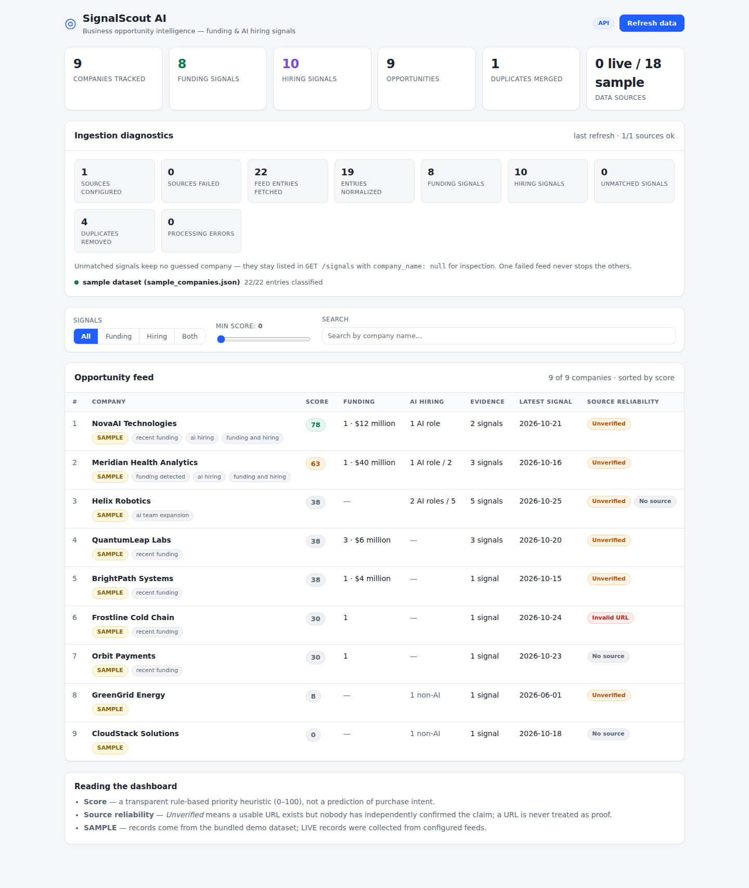
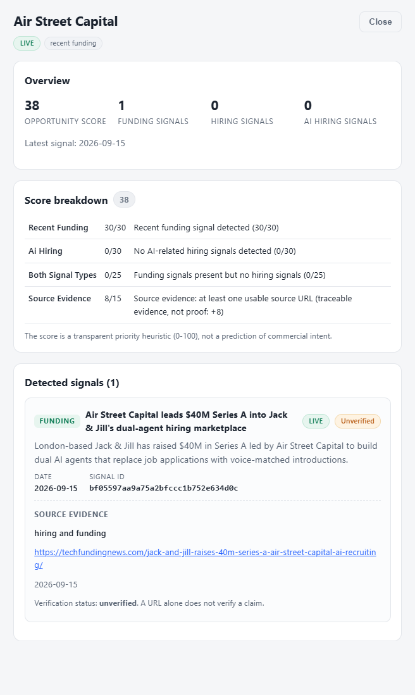

# SignalScout AI

A small business-signal discovery tool that helps make sense of company funding announcements and AI-related hiring activity.

SignalScout AI brings scattered company updates into one place. It collects signals from a sample dataset or public RSS/Atom feeds, organizes them by company, and highlights businesses that may be worth looking into.

The project started with a simple question: **what if I could spot companies that are growing their AI teams or have recently raised funding without manually checking dozens of websites?**

The result is a Python backend and React dashboard with a lightweight, explainable signal-processing pipeline.



## What it does

SignalScout currently focuses on two types of company activity:

- **Funding:** announcements about funding rounds and capital raised.
- **Hiring:** signals that a company is hiring for AI-related roles.

It takes incoming records through a processing pipeline and turns them into a company-level view. Instead of treating every article or feed entry as a separate opportunity, it tries to identify which reports refer to the same company or announcement.

The dashboard lets me browse the resulting companies, filter signals, inspect the evidence behind a score, and open the original source links.

## A look at the workflow

At a high level, the application works like this:

```text
Sample data / RSS and Atom feeds
              |
              v
        Data ingestion
              |
              v
        Normalization
              |
              v
      Funding / hiring detection
              |
              v
       Duplicate detection
              |
              v
       Source reliability
              |
              v
        Company matching
              |
              v
      Opportunity scoring
              |
              v
        FastAPI backend
              |
              v
        React dashboard
```

### 1. Collecting signals

The application can read from:

- A bundled sample dataset, which makes it possible to run the project without external services.
- Public RSS 2.0 and Atom feeds configured through `RSS_FEED_URLS`.

Each feed is handled independently. A timeout or parsing problem with one source should not prevent the other configured sources from being processed.

### 2. Normalizing and classifying records

Different sources represent the same information in different ways. The normalizer converts incoming records into a consistent signal structure, including cleaned company names, dates, signal types, amounts, and source information.

The detector then classifies records as `funding` or `hiring` using keyword-based rules.

This is deliberately rule-based at the moment. There is no hidden machine-learning model behind the classification.

### 3. Handling duplicates

A company announcement can appear on several websites. If every report is treated as a separate event, the same news can artificially increase a company's activity.

SignalScout handles duplicates in two stages:

- It removes records with duplicate signal IDs.
- It uses conservative cross-source matching to identify reports that appear to describe the same announcement, even when their IDs differ.

When reports are merged, the application retains the supporting source URLs and an explanation of the merge. The matching is intentionally conservative: it is better to leave a possible duplicate separate than to merge two unrelated announcements.

### 4. Grouping companies

Signals are grouped under a canonical company name so that variations in naming do not unnecessarily create separate company entries.

A company can have funding signals, hiring signals, or both. The dashboard presents the grouped information together.

### 5. Assessing source reliability

Every signal receives a source-reliability label:

| Label | Meaning |
|---|---|
| `missing_source` | No source URL was provided. |
| `invalid_source_url` | The supplied URL is malformed or uses an unsupported scheme. |
| `unverified` | A usable source URL exists, but the claim has not been independently checked. |
| `verified` | The claim has passed an explicit trusted verification process. |

An important distinction: **having a valid URL does not mean that an announcement has been verified.**

Automatic claim verification is not implemented yet, so normal incoming records remain unverified unless a trusted verification process is added later. The `verified` state is reserved for that future use.

### 6. Ranking opportunities

The opportunity score is a rule-based priority heuristic from 0 to 100. It is intended to help explore the collected signals, not to predict whether a company will become a customer.

The current scoring breakdown is:

| Factor | Maximum points | How it is calculated |
|---|---:|---|
| Recent funding | 30 | 30 for funding within 90 days; 15 for older or undated funding. |
| AI-related hiring | 30 | 30 for at least two AI-related hiring signals; 15 for one. |
| Funding and hiring together | 25 | Awarded when both signal types are present. |
| Source quality and evidence | 15 | 8 for a usable source URL and 7 for an explicitly verified source. |

The API returns a score breakdown with explanations for each factor, so the number is not just displayed without context.

A source URL contributes to traceability, not proof that a claim is true.

## Dashboard

The dashboard provides a quick overview of the processed data and a way to inspect individual companies.

Current views include:

- An overview of companies, funding and hiring signals, and ranked opportunities.
- A company feed with filters for funding, hiring, and combined activity.
- Reliability labels for missing, invalid, and unverified sources.
- Company detail pages with supporting signals and score explanations.
- Links to the original source material.
- Ingestion diagnostics for configured feeds.



## Tech stack

**Backend**
- Python 3.10+
- FastAPI and Uvicorn
- Standard-library RSS/Atom parsing and HTTP fetching

**Frontend**
- React 18
- TypeScript
- Vite
- CSS

**Testing**
- Python `unittest`
- FastAPI `TestClient`
- Mocked HTTP requests for ingestion tests

There is currently no database. Pipeline results are held in memory and cached for the lifetime of the backend process.

## Project structure

```text
SignalScout AI/
├── data/
│   └── sample_companies.json
├── src/
│   ├── main.py
│   ├── signal_detector.py
│   ├── source_reliability.py
│   ├── normalizer.py
│   ├── deduplicator.py
│   ├── company_matcher.py
│   ├── opportunity_scorer.py
│   ├── pipeline.py
│   ├── config.py
│   ├── ingestion/
│   │   ├── base.py
│   │   ├── rss_ingestion.py
│   │   └── sample_ingestion.py
│   └── api/
│       ├── routes.py
│       └── state.py
├── frontend/
│   └── src/
├── tests/
├── docs/
│   └── screenshots/
├── main.py
├── requirements.txt
├── .env.example
└── README.md
```

## Run it locally

You'll need **Python 3.10+** and **Node.js 18+**.

### 1. Clone the repository

```bash
git clone <your-repository-url>
cd "SignalScout AI"
```

### 2. Set up the backend

On Windows PowerShell:

```powershell
python -m venv .venv
.venv\Scripts\Activate.ps1
pip install -r requirements.txt
```

On Linux or macOS:

```bash
python3 -m venv .venv
source .venv/bin/activate
pip install -r requirements.txt
```

If PowerShell blocks virtual-environment activation, run:

```powershell
Set-ExecutionPolicy -Scope Process RemoteSigned
```

### 3. Set up the frontend

```bash
cd frontend
npm install
cd ..
```

### 4. Start the backend

From the project root, with the virtual environment activated:

```bash
python main.py
```

The API runs at `http://127.0.0.1:8000`.

Interactive API documentation is available at `http://127.0.0.1:8000/docs`.

### 5. Start the dashboard

In a second terminal:

```bash
cd frontend
npm run dev
```

Open the local URL printed by Vite, usually `http://localhost:5173`.

Start the backend before opening the dashboard.

## Configure RSS feeds (optional)

The project works without API keys or external services. By default, it uses the bundled sample dataset.

To try live ingestion, copy `.env.example` to `.env` and set the feed URLs:

```env
RSS_FEED_URLS=https://example.com/feed.xml
INCLUDE_SAMPLE_DATA=true
```

Multiple feed URLs can be provided as a comma-separated list.

A few other available settings:

| Variable | Default | Purpose |
|---|---|---|
| `RSS_FEED_URLS` | Empty | Comma-separated RSS/Atom feed URLs. |
| `INCLUDE_SAMPLE_DATA` | `true` | Include the bundled sample records. |
| `SAMPLE_DATA_FILE` | `data/sample_companies.json` | Sample dataset path. |
| `INGEST_TIMEOUT` | `10` | Timeout per feed, in seconds. |
| `RECENT_WINDOW_DAYS` | `90` | Funding recency window used by scoring. |
| `API_HOST` | `127.0.0.1` | Backend bind address. |
| `API_PORT` | `8000` | Backend port. |
| `CORS_ORIGINS` | Vite dev/preview origins | Allowed frontend origins. |
| `VITE_API_URL` | `http://127.0.0.1:8000` | Backend URL used by the frontend build. |

The `.env` file is ignored by Git. Keep private configuration out of commits.

## API overview

The backend exposes these endpoints:

| Endpoint | Purpose |
|---|---|
| `GET /` | API health and project information. |
| `GET /health` | Health check. |
| `GET /stats` | Overview metrics and ingestion diagnostics. |
| `GET /companies` | Company list, with filters such as `signal_type`, `q`, `min_score`, and `limit`. |
| `GET /signals` | Normalized signals, filterable by type, company, date window, and limit. |
| `GET /opportunities` | Ranked opportunities, with score and sorting filters. |
| `GET /companies/{name}` | Company details, supporting signals, and score breakdown. |
| `POST /ingest` | Re-runs ingestion for the sources configured in the environment. |

The ingestion endpoint only uses configured sources; it does not accept arbitrary URLs in the request body.

## Tests

Run the backend test suite from the project root:

```bash
python -m unittest discover -s tests -v
```

You can also run a syntax/import check:

```bash
python -m compileall src tests
```

Build the frontend:

```bash
cd frontend
npm run build
```

The tests mock external HTTP requests, so the backend test suite does not need internet access.

## Sample data

The bundled file at `data/sample_companies.json` contains synthetic records for development and testing. The company names and announcements in it are examples, not real business news.

The sample data covers cases such as:

- Companies with funding signals only, hiring signals only, or both.
- Multiple hiring or funding records for one company.
- Duplicate signal IDs.
- The same announcement reported by two sources with different IDs.
- Missing or malformed source URLs.
- Missing optional fields and alternate date formats.
- Records with missing or null signal lists.

The dashboard labels sample records clearly so they are not mistaken for live announcements.

## Current limitations

There are a few things worth keeping in mind when using the project:

- **Classification is rule-based.** Funding and hiring detection use keywords and rules rather than an ML model.
- **No automatic fact-checking.** A source URL provides a way to inspect a claim; it does not establish that the claim is true.
- **Feed quality matters.** General news feeds can contain many entries unrelated to funding or AI hiring. The current extraction rules intentionally avoid guessing a company when the title is ambiguous.
- **Duplicate matching is conservative.** Heavily paraphrased reports may not be merged. This avoids incorrectly combining unrelated announcements.
- **No persistent storage.** Results are cached in memory and are recalculated when the backend restarts.
- **Ingestion is synchronous.** A refresh runs in the request cycle. Each feed has a timeout, but several slow feeds can make a refresh take longer.
- **No authentication.** The API is currently intended for local development and demonstration, not as a publicly exposed multi-user service.
- **Scores are not validated business predictions.** They are a transparent way to prioritize records for further investigation.

## Ideas for improvement

Some directions I'd like to explore next:

- Add trusted verification sources and a clear process for corroborating announcements.
- Persist ingested signals so duplicate detection can work across separate runs.
- Add more sources, such as company blogs, job boards, and funding databases.
- Improve cross-source matching with semantic similarity, evaluated against a labeled dataset.
- Let users customize scoring weights and save filters.
- Add exports and email or Slack summaries.
- Add authentication and support for multiple users.

---

*Built as a personal project to explore data ingestion, signal processing, explainable scoring, API design, and a practical React dashboard.*
