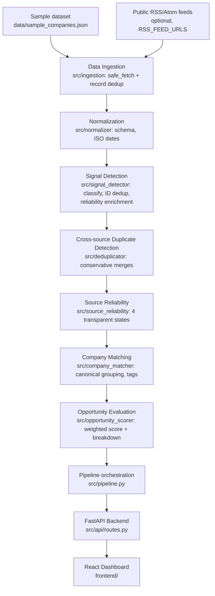

# SignalScout AI

**AI-team and funding signal intelligence for founders, startups and small businesses.**

SignalScout AI collects company-related business signals — companies announcing
funding and companies hiring AI engineers — normalizes them, classifies them,
removes duplicate reports across sources, labels how reliable each source is,
groups signals per company, and ranks companies with a transparent rule-based
opportunity score through a simple dashboard.

> **Honesty note:** scoring and classification are **explainable rules, not
> machine-learning models**, and the demo runs on a **clearly labeled synthetic
> sample dataset** unless you configure live RSS feeds. Nothing in this system
> "verifies" a claim automatically, and the opportunity score is a priority
> heuristic — not a prediction that a company will buy anything.

---

## 1. Problem statement

Useful business signals are scattered across news sites, company blogs and job
boards. Manually tracking which companies just raised capital or are building
out AI teams is slow and repetitive, and raw reports are noisy:

- the same announcement appears on multiple sites with different IDs,
- some reports have no source or a broken source,
- funding news and job posts arrive in inconsistent formats,
- "who looks most interesting right now?" requires manual judgement each time.

## 2. What SignalScout AI does

1. **Ingests** records from the bundled sample dataset and/or public RSS/Atom feeds.
2. **Normalizes** them into one consistent signal schema (dates, company names,
   signal types, amounts, sources).
3. **Classifies** signals as `funding` or `hiring` using explainable keyword rules.
4. **Deduplicates** in two stages: identical `signal_id`s, then conservative
   cross-source matching of the same announcement reported by different sites.
5. **Assesses source reliability** transparently: `missing_source`,
   `invalid_source_url`, `unverified`, `verified`.
6. **Groups signals per company** (canonical name matching, no duplicate entries).
7. **Scores and ranks opportunities** with a rule-based, fully explainable
   breakdown (0–100).
8. **Serves everything through a FastAPI backend** and a React dashboard with
   filters, company detail views, source-evidence links and loading/empty/error
   states.

## 3. Target users

- Founders and GTM teams looking for timely, evidence-backed prospects.
- Small businesses tracking which companies are scaling (funding + AI hiring).
- Anyone who needs **auditable** signal data: every score links back to the
  exact signals and source URLs that produced it.

## 4. Key features

| Feature | Implementation |
|---|---|
| Funding & hiring classification | Keyword/rule based (`src/signal_detector.py`, `src/ingestion/rss_ingestion.py`) |
| Normalized signal schema | `src/normalizer.py` (ISO dates, cleaned names/amounts, missing fields → `null`) |
| ID-based deduplication | `src/signal_detector.deduplicate_signals` |
| Cross-source duplicate detection | `src/deduplicator.py` (conservative, explained merges) |
| Source reliability labels | `src/source_reliability.py` (4 transparent states) |
| Company matching | `src/company_matcher.py` (canonical names, opportunity tags) |
| Opportunity scoring | `src/opportunity_scorer.py` (100-point weighted breakdown) |
| Ingestion layer | `src/ingestion/` (sample fixture + RSS/Atom, per-source failure isolation) |
| API | FastAPI (`src/api/routes.py`, 8 endpoints) |
| Dashboard | React + Vite + TypeScript (`frontend/`) |
| Tests | 179 `unittest` tests, no network required |

## 5. How the pipeline works

```text
Data Sources            (sample_companies.json, optional RSS/Atom feeds)
     |  per-source timeout + failure isolation (safe_fetch)
     v
Data Ingestion          (src/ingestion — raw records, in-run record dedup)
     |
     v
Normalization           (src/normalizer — one signal schema, ISO dates,
     |                   untrusted verification flags discarded)
     v
Signal Detection        (src/signal_detector — funding/hiring classification,
     |                   signal_id dedup, reliability enrichment)
     v
Duplicate Detection     (src/deduplicator — cross-source merges that keep
     |                   every supporting source URL + merge explanation)
     v
Source Reliability      (missing_source / invalid_source_url /
     |                   unverified / verified)
     v
Company Matching        (src/company_matcher — canonical grouping, tags)
     |
     v
Opportunity Evaluation  (src/opportunity_scorer — weighted score + reasons)
     |
     v
FastAPI Backend         (src/api — filtering, validation, caching)
     |
     v
React Dashboard         (frontend/ — overview, feed, filters, detail view)
```

## 6. Architecture



## 7. Technology stack

**Backend:** Python 3.10+ (tested on 3.14), FastAPI, Uvicorn, standard library
(`xml.etree` for feeds, `urllib` for fetches, `pathlib` for paths).
No database — results are computed in memory and cached per process.

**Frontend:** React 18, TypeScript (strict), Vite 5, plain CSS (no UI framework).

**Testing:** `unittest` + `fastapi.testclient` (mocked HTTP — tests never touch
the network).

## 8. Project structure

```text
SignalScout AI/
├── data/
│   └── sample_companies.json        # clearly synthetic sample dataset
├── src/
│   ├── __init__.py
│   ├── main.py                      # FastAPI app factory (uvicorn src.main:app)
│   ├── signal_detector.py           # classification + ID dedup + enrichment
│   ├── source_reliability.py        # transparent reliability states
│   ├── normalizer.py                # signal schema normalization
│   ├── deduplicator.py              # cross-source duplicate detection
│   ├── company_matcher.py           # company grouping + opportunity tags
│   ├── opportunity_scorer.py        # weighted, explainable scoring
│   ├── pipeline.py                  # end-to-end orchestration
│   ├── config.py                    # environment-driven settings
│   ├── ingestion/
│   │   ├── base.py                  # BaseSource, safe_fetch, record dedup
│   │   ├── rss_ingestion.py         # RSS 2.0 / Atom (stdlib, timeout)
│   │   └── sample_ingestion.py      # bundled fixture loader
│   └── api/
│       ├── routes.py                # endpoints
│       └── state.py                 # thread-safe pipeline cache
├── frontend/
│   ├── src/                         # React dashboard (TypeScript)
│   └── package.json
├── tests/                           # 179 unittest tests
├── docs/screenshots/                # dashboard screenshots
├── main.py                          # entry point (python main.py)
├── requirements.txt
├── .env.example
└── README.md
```

## 9. Installation (Windows)

Prerequisites: **Python 3.10+** and **Node.js 18+**.

```powershell
# 1. Create and activate a virtual environment
python -m venv .venv
.venv\Scripts\Activate.ps1

# 2. Install backend dependencies
pip install -r requirements.txt

# 3. (Optional) install frontend dependencies
cd frontend
npm install
cd ..
```

> If PowerShell blocks activation, run once:
> `Set-ExecutionPolicy -Scope Process RemoteSigned`

Linux/macOS equivalents: `python3 -m venv .venv`, `source .venv/bin/activate`.

## 10. Environment configuration

Copy `.env.example` to `.env` if you want to change defaults. **Every setting
has a working default — no API keys are required and none exist in this repo.**

On startup the backend loads a simple `KEY=VALUE` file from the project root
(`.env`) using a small built-in parser (no extra dependency). Real environment
variables always take precedence over `.env` values, so exported variables and
CI overrides keep working.

| Variable | Default | Purpose |
|---|---|---|
| `RSS_FEED_URLS` | *(empty)* | Comma-separated public feeds to ingest live |
| `INCLUDE_SAMPLE_DATA` | `true` | Load the bundled sample dataset |
| `SAMPLE_DATA_FILE` | `data/sample_companies.json` | Sample dataset location |
| `INGEST_TIMEOUT` | `10` | Feed request timeout (seconds) |
| `RECENT_WINDOW_DAYS` | `90` | Funding recency window for scoring |
| `API_HOST` / `API_PORT` | `127.0.0.1` / `8000` | Server bind address |
| `CORS_ORIGINS` | Vite dev/preview origins | Allowed browser origins |
| `VITE_API_URL` | `http://127.0.0.1:8000` | Backend URL baked into the dashboard build |

`.env` is git-ignored; `.env.example` contains no secrets.

## 11. Running the backend

```powershell
# from the project root, with the virtual environment activated
python main.py
# equivalent: python -m uvicorn main:app --host 127.0.0.1 --port 8000
```

The API listens on `http://127.0.0.1:8000` (interactive docs at `/docs`).

| Endpoint | Purpose |
|---|---|
| `GET /` | API health and project information |
| `GET /health` | Health check |
| `GET /stats` | Overview metrics (used by the dashboard header cards) |
| `GET /companies` | Companies — filters: `signal_type`, `q`, `min_score`, `limit` |
| `GET /signals` | Normalized signals — filters: `signal_type`, `company`, `days`, `limit` |
| `GET /opportunities` | Ranked opportunities — filters: `min_score`, `sort`, `limit` |
| `GET /companies/{name}` | Company detail + supporting signals + score breakdown |
| `POST /ingest` | Re-runs ingestion for the **configured sources only** (no arbitrary URLs accepted) |

## 12. Running the frontend

```powershell
cd frontend

# development server (http://localhost:5173)
npm run dev

# production build (output in frontend/dist)
npm run build

# serve the production build (http://localhost:4173)
npm run preview
```

Start the backend first, then open the dashboard URL. The dashboard reads
`VITE_API_URL` (default `http://127.0.0.1:8000`); the backend's default CORS
policy already allows the Vite dev and preview origins.

## 13. Running tests

```powershell
# backend test suite (197 tests, no internet needed)
python -m unittest discover -s tests -v

# syntax/import check
python -m compileall src tests

# frontend type-check + production build
cd frontend
npm run build
```

Tests mock all external requests — they pass with no network access.

The full suite is green on Linux (Python 3.13) and on Windows (Python 3.13,
same `requirements.txt`).

## 14. Sample data explanation

`data/sample_companies.json` contains **synthetic demo records** for testing
realistic scenarios. They are **not real companies or real announcements**, and
the dashboard labels them with a `SAMPLE` badge and a banner
(`data_origin: "sample"`). The dataset intentionally covers:

| Scenario | Where |
|---|---|
| Funding-only company | BrightPath Systems, QuantumLeap Labs, Orbit Payments |
| Hiring-only company | CloudStack Solutions, Helix Robotics, GreenGrid Energy |
| Both signal types | NovaAI Technologies, Meridian Health Analytics |
| Multiple hiring records | Helix Robotics (5), Meridian Health Analytics |
| Multiple funding records | QuantumLeap Labs (3) |
| Duplicate `signal_id`s | BrightPath, Orbit, GreenGrid (removed at detection) |
| Same announcement from two sources with different IDs | NovaAI `FUNDING001` + `TECHDAILY_7788` → cross-source merge with both URLs preserved |
| Missing source URL | CloudStack Solutions, Orbit Payments |
| Invalid source URL | Frostline Cold Chain (`htp:/broken-link` → `invalid_source_url`) |
| Missing optional fields | Frostline (no description/amount), Orbit (no amount) |
| Alternate date format | Frostline (`2026/10/24`, parsed to ISO) |
| Missing / null `signals` | Lumen Retail Tech, Vertex Security (handled, no crash) |

## 15. Signal reliability explanation

Every signal carries a `source_reliability` label:

| Label | Meaning |
|---|---|
| `missing_source` | No source URL was provided |
| `invalid_source_url` | URL is malformed or uses an unsupported scheme |
| `unverified` | A usable URL exists, but the claim has **not** been independently checked |
| `verified` | The claim passed an explicit trusted verification process |

Important details:

- **A URL never means "verified".** Valid-but-unverified sources are the norm.
- Incoming `verification_status` fields from raw data are **discarded during
  normalization** — only trusted application logic can assign `verified`.
- No automated claim-verification process is implemented in this version, so in
  practice everything is `unverified`/`missing_source`/`invalid_source_url`.
  The `verified` state exists for future trusted backends and is unit-tested.
- The dashboard states this uncertainty explicitly in the detail view.

## 16. Opportunity scoring explanation

Scores are a **transparent priority heuristic (0–100)**, computed from actual
signal data with fixed weights (configurable in `src/opportunity_scorer.py`):

| Factor | Weight | Rule |
|---|---:|---|
| Recent funding announcement | 30 | 30 if funding within 90 days, 15 if older/undated, 0 if none |
| Multiple AI-related hiring signals | 30 | 30 if ≥2 AI-role hiring signals, 15 if exactly 1, 0 if none |
| Funding **and** hiring present | 25 | 25 only when both types exist |
| Source quality / evidence | 15 | +8 for any usable source URL (traceability, **not proof**), +7 only for explicitly verified sources |

Every score ships with a `score_breakdown` listing each factor's points,
maximum and a human-readable explanation, plus the supporting signals
(`evidence_count`). **Missing data never earns maximum points**, and the score
is **not** a probability of commercial intent.

## 17. Demo walkthrough

The demo runs entirely offline, with no API keys:

1. **Start the backend** — `python main.py` (API on `:8000`).
2. **Start the dashboard** — `cd frontend && npm run dev` (or `npm run build && npm run preview`).
3. **Overview** — cards show companies (9), funding (8), hiring (10), opportunities (9), duplicates merged (1) and `0 live / 18 sample`.
4. **Sample labeling** — the SAMPLE banner and badges make demo data obvious.
5. **Funding & hiring detection** — filter the feed by Funding / Hiring / Both.
6. **Reliability labels** — each row shows badges (e.g. Frostline: *Invalid URL*; CloudStack: *No source*).
7. **Duplicate detection** — open **NovaAI Technologies**: its Series A funding signal shows *“Grouped from 2 reports”* with both source URLs and the merge reason.
8. **Company grouping** — the feed lists exactly one row per canonical company.
9. **Opportunity ranking** — rows are sorted by score (NovaAI 78 → Meridian 63 → …).
10. **Company detail & evidence** — click a row: score breakdown, all signals, dates, source names and clickable source URLs.

Live ingestion, if configured (`RSS_FEED_URLS`), is demonstrated separately:
records from feeds are labeled `LIVE` and appear alongside sample data.

## 18. Limitations

- **Sample-first demo.** The default configuration uses only the synthetic
  sample dataset (with `data_origin: sample`). The RSS/Atom ingestion layer is
  implemented and was validated end-to-end against a real public feed during
  the final hardening pass (see *Verification status*): the configured feed was
  fetched, entries normalized, classified, scored and reported. Failures are
  reported per source and never crash the app.
- **General-news feeds produce mostly unmatched entries.** The live feed used
  during final validation (`https://rss.app/feeds/tbquXa0CkNBOAavA.xml` via
  `RSS_FEED_URLS`) is a general news aggregator; most headlines are unrelated to
  funding/AI-hiring signals and correctly stay unmatched (company guessed: none).
  A startup-/funding-focused feed yields tighter results; the extraction layer is
  intentionally conservative and never guesses company names from sentences
  (verified: e.g. "Metaview wants to eliminate recruiting grunt work …" →
  `Metaview`; "Financial services hiring is looking up …" → no company).
- **Rule-based, not AI/ML.** Classification and scoring are keyword/weighted
  rules. No model training or inference happens anywhere.
- **No automatic verification.** Nothing here confirms a claim is true; the UI
  says so explicitly. Live signals are always labeled `unverified`.
- **Conservative cross-source dedup.** Heavily paraphrased reports of the same
  announcement may stay separate (false negatives); thresholds exist to avoid
  merging unrelated announcements instead.
- **Conservative company extraction from RSS titles.** Items whose titles do
  not clearly start with a company name produce signals with no company and are
  counted as unmatched rather than guessed.
- **No persistence.** Pipeline results are cached in memory per process;
  restarting the server re-runs the pipeline. No database is used.
- **Synchronous ingestion with timeouts.** `POST /ingest` (and the first
  request) runs the pipeline in the request cycle with a 10 s per-feed
  timeout. With the default sample-only configuration this is effectively
  instant; with several slow live feeds, a refresh can take a few seconds
  and concurrent refreshes wait on a lock instead of running in the
  background.
- **Scoring is a heuristic**, tunable but not validated against real sales outcomes.
- **No authentication** on the API — intended for local demo use only.

## 19. Future improvements

- Trusted verification backends (e.g. corroborating a claim across ≥2
  independent reputable sources) to promote signals to `verified`.
- Deduplicating cross-run feed items via a persistent store; additional source
  types (job boards, company blogs, funding databases with free tiers).
- ML-assisted semantic title matching for cross-source dedup, evaluated against
  a labeled duplicate dataset.
- Per-team score weighting, email/Slack digests, export endpoints (CSV/JSON).
- Authentication and multi-user saved filters.

## 20. Screenshots


---

## Verification status

Final pre-submission validation (Section 21 hardening):

| Check | Result |
|---|---|
| `python -m unittest discover -s tests -v` | **197/197 passing** (Linux + Windows Python 3.13) |
| `python -m compileall src tests` | clean |
| `npm run build` (type-check + production build) | clean |
| Live API pass (19 endpoint checks incl. filters, 404/422, ingest) | 19/19 |
| Browser end-to-end (Chromium, production build) | 22/22 (feed, metrics, filters, detail, evidence links, refresh, error state) |
| Live feed validation (user-configured feed via `RSS_FEED_URLS`) | OK — feed fetched, 18 entries → 18 signals, 0 processing errors, unmatched preserved |
| Network access in tests | none required (all HTTP mocked) |

Notes from the final hardening pass:

- **Live feed:** the feed configured in `.env`
  (`RSS_FEED_URLS=https://rss.app/feeds/tbquXa0CkNBOAavA.xml`) was fetched and
  processed through the full pipeline. Diagnostics reported 1 source OK, 0
  failed, 22 entries fetched (1 source), 19 normalized, 8 funding / 10 hiring
  signals, 0 unmatched, 0 processing errors, 1 duplicate merged. Source URLs and
  publication dates were preserved; every live signal was labeled
  `unverified`.
- **Ingestion diagnostics:** `GET /stats` now returns a structured
  `diagnostics` block (sources configured/succeeded/failed, feed entries
  fetched/normalized, funding/hiring/unmatched signals, duplicates removed,
  processing errors). The dashboard renders an *Ingestion diagnostics* panel.
- **RSS company extraction:** hardened during final validation — supports
  additional announcement verbs (`hits`, `reaches`, `nabs`, `scores`, `banks`,
  `acquires`, …), strips descriptor prefixes (`"Legal AI startup Legora …"` →
  `Legora`) and location tags (`"OpenAI-backed …"` → `Thrive Holdings`), rejects
  sentence-shaped candidates and generic/civic words, and keeps candidate length
  ≤ 6 tokens.
- **Windows setup verification:** completed on real Windows (PowerShell 5.1,
  Python 3.13.3, Node 22): venv creation → activation → dependency install →
  backend start → frontend start → backend tests — all executed via the real
  Windows commands and confirmed working.

## Final report

Delivered in the final response to the user: live feed tested, entries fetched
and processed, matched/unmatched counts, cross-source dedup test results,
Windows setup verification results, full backend test results, frontend build
results, remaining limitations, and exact commands for the final demo.
